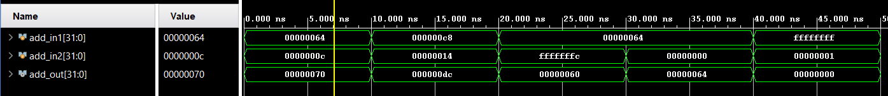
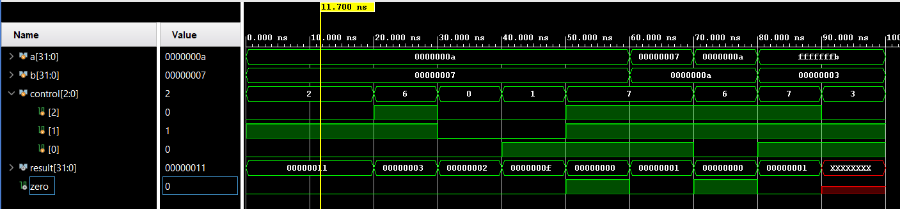
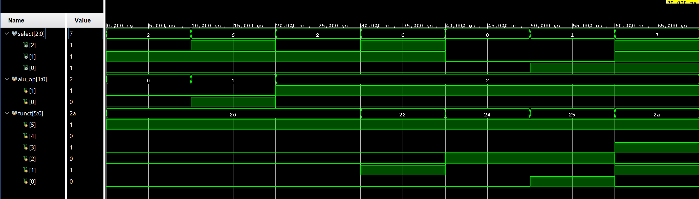
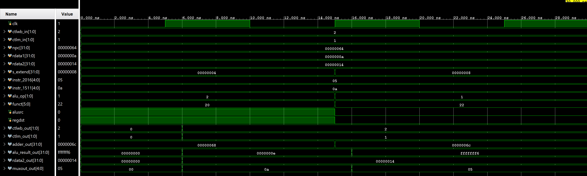

# Lab 3 - Execute

## Design Scope and Assumptions
In Scope:
Implementation of the Instruction Execute (EX) stage of a 32-bit MIPS pipeline using 6 components:
Adder, Top Mux, ALU, ALU Control, Bottom Mux, EX/Mem Pipeline Latch

Out of Scope:
Writeback, Memory, ALU Source, ALUOp, Register Destination, and forwarding logic

Assumption:
  - 

Limitations: 
  - 

## Requirements
| Requirement | Description | Verification Method |
|---|---|---|

## Implementation
### Source Code
| File | Description |
|---|---|

### Implementation Notes

## Verification
### Verification Strategy
The design is verified using Verilog behavioral simulation and timing diagrams. Each component is tested individually to verify its functionality before being connected into a complete Execute Stage. 

Verification Covers: 
  - 

### Testbench and Waveform

The Adder Testbench source is available [*here*](https://github.com/BlackFlameFlame/ECE4300-Coding-Assignment/blob/main/Instruction%20Execute/adder_tb.v)

The ALU Testbench source is available [*here*](https://github.com/BlackFlameFlame/ECE4300-Coding-Assignment/blob/main/Instruction%20Execute/alu_tb.v)

The ALU Control Testbench source is available [*here*](https://github.com/BlackFlameFlame/ECE4300-Coding-Assignment/blob/main/Instruction%20Execute/alu_control_tb.v)

The Execute Testbench source is available [*here*](https://github.com/BlackFlameFlame/ECE4300-Coding-Assignment/blob/main/Instruction%20Execute/execute_tb.v)
