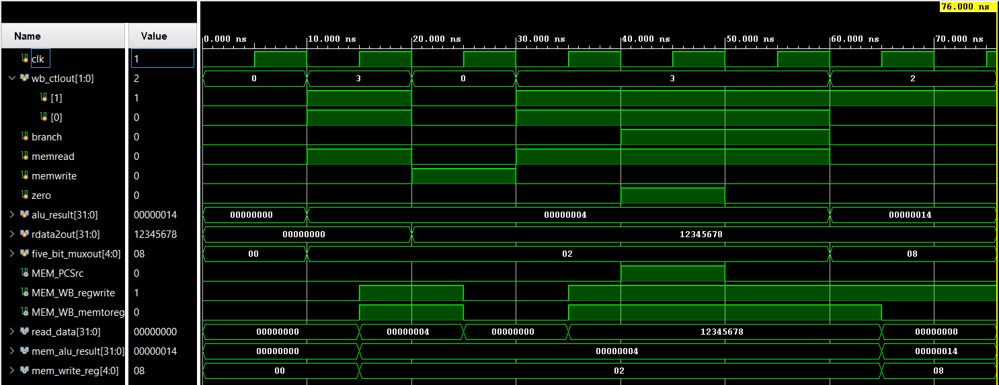
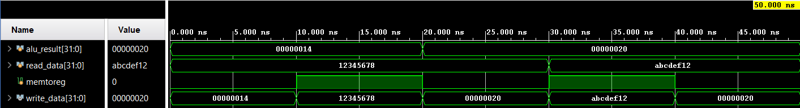

# Lab 4 - Memory and Write-Back

## Design Scope and Assumptions
In Scope:
Implementation of the Memory (MEM) and Write-Back (WB) stages of a 32-bit MIPS pipeline using 4 components:
AND, Data Memory, MEM/WB Pipeline Latch, Write-Back Mux

Out of Scope:
Instruction Fetch, Instruction Decode, Execute, Hazard detection

Assumption:
- The Memory stage receives the ALU result, register data, destination register, and control signals from the Execute stage through the EX/MEM pipeline latch
- Data Memory contains 256 words of 32-bit memory, with the initial values loaded from data.txt
- The ALU result serves as the memory address for Load Word (LW) and Store Word (SW) instructions
- Memory writes and MEM/WB latch updates occur on the rising edge of the clock, while memory reads use combinational logic
- The AND gate determines whether a branch is taken using the Branch control signal and Zero flag
- The MEM/WB pipeline latch stores the Write-Back control signals, memory data, ALU result, and destination register
- The Write-Back Mux selects between memory data and the ALU result using MemToReg

Limitations: 
- Data Memory supports only 256 memory locations, each containing 32 bits
- The memory implementation uses direct word-index addressing rather than byte-addressed memory
- The Memory stage supports memory operations for LW and SW, branch decisions for BEQ, and passing ALU results for R-type instructions
- Simultaneous memory reading and writing are not included in the intended instruction operations
- The Memory stage relies on the Execute stage to provide valid addresses, data, and control signals
- The Write-Back Mux selects the data to be written but does not directly update the register file

## Requirements
| Requirement | Description | Verification Method |
|---|---|---|
|AND|Performs a logical AND operation between Branch and Zero to determine PCSrc|memoryTB.v|
|Data Memory|Reads or writes 32-bit data at the address specified by the ALU result|memoryTB.v|
|MEM/WB Latch|Stores Write-Back control signals, memory data, ALU result, and destination register on rising clock edges|memoryTB.v|
|Memory Stage|Connects the AND gate, Data Memory, and MEM/WB pipeline latch|memoryTB.v|
|WB MUX|Selects memory data or the ALU result using MemToReg|InstMemWBMux_tb.v|

## Implementation
### Source Code
| File | Description |
|---|---|
|[‘AND.v’](https://github.com/BlackFlameFlame/ECE4300-Coding-Assignment/blob/e93da147de7e11a6d4c373adaaec98915c021042/Instruction%20Memory%20Writeback/AND.v)|Determines whether a branch is taken using the Branch signal and Zero flag|
|[‘data_memory.v’](https://github.com/BlackFlameFlame/ECE4300-Coding-Assignment/blob/e93da147de7e11a6d4c373adaaec98915c021042/Instruction%20Memory%20Writeback/data_memory.v)|Implements 256 words of 32-bit memory with synchronous writing and asynchronous reading|
|[‘data.txt’](https://github.com/BlackFlameFlame/ECE4300-Coding-Assignment/blob/e93da147de7e11a6d4c373adaaec98915c021042/Instruction%20Memory%20Writeback/data.txt)|Initializes the first six Data Memory locations with values 0 through 5|
|[‘mem_wb.v’](https://github.com/BlackFlameFlame/ECE4300-Coding-Assignment/blob/e93da147de7e11a6d4c373adaaec98915c021042/Instruction%20Memory%20Writeback/mem_wb.v)|Stores the memory data, ALU result, destination register, and Write-Back control signals on rising clock edges|
|[‘MEMORY.v’](https://github.com/BlackFlameFlame/ECE4300-Coding-Assignment/blob/e93da147de7e11a6d4c373adaaec98915c021042/Instruction%20Memory%20Writeback/MEMORY.v)|Connects the AND gate, Data Memory, and MEM/WB pipeline latch into the Memory stage.|
|[‘memoryTB.v’](https://github.com/BlackFlameFlame/ECE4300-Coding-Assignment/blob/e93da147de7e11a6d4c373adaaec98915c021042/Instruction%20Memory%20Writeback/memoryTB.v)|Tests memory reading, writing, branch decisions, and the MEM/WB pipeline latch|
|[‘InstrMemWBMux.v’](https://github.com/BlackFlameFlame/ECE4300-Coding-Assignment/blob/e93da147de7e11a6d4c373adaaec98915c021042/Instruction%20Memory%20Writeback/InstrMemWBMux.v)|Selects between memory data and the ALU result using MemToReg|
|[‘InstrMemWBMux_tb.v’](https://github.com/BlackFlameFlame/ECE4300-Coding-Assignment/blob/e93da147de7e11a6d4c373adaaec98915c021042/Instruction%20Memory%20Writeback/InstrMemWBMux_tb.v)|Tests the Write-Back MUX using different input values and MemToReg selections|

### Implementation Notes
The Memory and Write-Back stages were implemented using Verilog HDL in Xilinx Vivado. The Memory stage consists of an AND gate, Data Memory, and MEM/WB pipeline latch connected through the MEMORY.v top module. The AND gate combines the Branch and Zero signals to determine whether the processor should take a branch. Data Memory uses the ALU result as the address to read or write data, depending on the MemRead and MemWrite control signals. The MEM/WB pipeline latch stores the memory data, ALU result, destination register, and Write-Back control signals on the rising edge of the clock.

The Write-Back Mux is implemented separately from the Memory top module. It selects between the memory data and ALU result based on MemToReg. The selected value, along with the RegWrite signal and destination register, is sent back to the Decode stage's register file during full pipeline integration.

## Verification
### Verification Strategy
The design is verified using Verilog behavioral simulation and timing diagrams in Xilinx Vivado. The Memory stage testbench verifies Load Word (LW), Store Word (SW), branch decisions associated with Branch if Equal (BEQ), and the transfer of ALU results for R-type instructions. The Write-Back Mux is tested separately by changing MemToReg to verify the selection between memory data and the ALU result.

The Memory stage waveform shows that LW successfully reads the initialized value of 4 from memory address 4. SW then writes hexadecimal 12345678 to the same address, and a subsequent LW reads back the stored value. The BEQ branch decision test verifies that PCSrc becomes 1 only when both Branch and Zero are 1. Finally, the R-type test verifies that the MEM/WB pipeline latch captures the ALU result of 20 and destination register 8 on the rising clock edge. 

Verification Covers: 
  - Verifies that PCSrc becomes 1 only when Branch and Zero are both 1
  - Verifies reading initialized memory data, writing new data, and reading back the updated value
  - Verifies that memory data, ALU result, destination register, and Write-Back control signals are captured on rising clock edges
  - Verifies LW, SW, BEQ branch conditions, and R-type Write-Back control behavior
  - Verifies that MemToReg selects memory data when 1 and the ALU result when 0

### Testbench and Waveform

The MEM/WB testbench source is available [*here*](https://github.com/BlackFlameFlame/ECE4300-Coding-Assignment/blob/e93da147de7e11a6d4c373adaaec98915c021042/Instruction%20Memory%20Writeback/memoryTB.v)

The MEM/WB MUX testbench source is available [*here*](https://github.com/BlackFlameFlame/ECE4300-Coding-Assignment/blob/e93da147de7e11a6d4c373adaaec98915c021042/Instruction%20Memory%20Writeback/InstrMemWBMux_tb.v)

